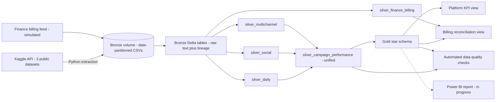
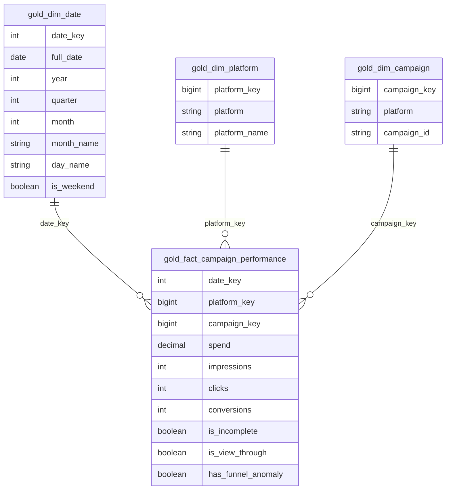

# Media Campaign Performance Pipeline

End-to-end data engineering project on **Databricks**: API extraction from Kaggle, a **medallion architecture** (bronze → silver → gold), a **star schema** with correctly calculated advertising KPIs, **automated data quality checks**, and a **finance billing reconciliation** that catches real-world invoice discrepancies.

---

## Contents

- [The business problem](#the-business-problem)
- [Architecture](#architecture)
- [Data sources](#data-sources)
- [Pipeline layers](#pipeline-layers)
- [Star schema](#star-schema)
- [KPIs and the averaging trap](#kpis-and-the-averaging-trap)
- [Data quality](#data-quality)
- [Finance reconciliation](#finance-reconciliation)
- [Key engineering decisions](#key-engineering-decisions)
- [Data limitations](#data-limitations)
- [Repository structure and run order](#repository-structure-and-run-order)
- [Roadmap](#roadmap)

---

## The business problem

Media agencies receive daily delivery data from several advertising platforms. Each platform uses different file formats, column names and quirks. The data team has to combine them, clean them, calculate performance metrics correctly, and reconcile what platforms report against what finance is actually billed, before any number reaches a client.

This project builds that pipeline from scratch.

---

## Architecture

| Layer | Purpose | Rule |
|---|---|---|
| **Bronze** | Data exactly as received | Never modified; everything stored as text, plus `_source_file` and `_ingested_at` for lineage |
| **Silver** | Cleaned, typed, standardised | Every transformation reads from bronze and writes a new table |
| **Gold** | Modelled for analysis | Star schema and KPI logic, built only from silver |

---

## Data sources

| Role in project | Dataset | Rows | Notes |
|---|---|---|---|
| Social platform | Kaggle: Clicks Conversion Tracking | 1,143 | Ad-level Facebook campaign data; **no date column** |
| Daily campaign platform | Kaggle: A/B Testing dataset | 60 | Daily control and test campaigns, August 2019; semicolon-delimited |
| Multichannel platform | Kaggle: Marketing Campaign Performance | 200,000 | **Fictional dataset**, used for volume; one row per campaign, 2021 |
| Finance billing | Generated from delivered spend | 15 | **Simulated**, with five documented discrepancies (see [reconciliation](#finance-reconciliation)) |

Extraction uses the Kaggle API from a Databricks notebook. The API token is stored in a Unity Catalog volume and read at runtime; it is never written into code or committed to this repository.

---

## Pipeline layers

<b>Bronze: extraction and raw landing</b> (click to expand)

- Python extraction from the Kaggle API into date-partitioned folders: `bronze/<platform>/ingest_date=YYYY-MM-DD/`
- Downloads go to a temporary folder first and are copied to bronze only on success, so a failed download never lands half-written files
- **Error isolation:** one failing source does not stop the others
- A **manifest** records each run's files, row counts and status
- Raw files loaded into bronze Delta tables as text, with only a technical rename of characters Delta does not allow in column names
- Extraction is **idempotent**: rerunning overwrites the same day's files without creating duplicates

<b>Silver: cleaning and standardisation</b> (click to expand)

Issues found during profiling, and how each was handled:

| Source | Issue | Handling |
|---|---|---|
| Daily | Semicolon delimiter | Explicit `sep` per source |
| Daily | Date format `d.MM.yyyy` | Explicit date parsing |
| Daily | 5 Aug 2019 has spend but no performance data | Kept, flagged `is_incomplete` |
| Daily | Purchases above add-to-carts on some days | Kept, flagged `has_funnel_anomaly` (9 days) |
| Social | 204 ads with conversions but zero clicks | Kept as **view-through conversions**, flagged `is_view_through` |
| Multichannel | Cost stored as text like `$16,174.00` | Symbols removed before conversion |
| Multichannel | Duration stored as `30 days` | Number extracted |

The three source tables are combined with `UNION ALL` into `silver_campaign_performance`, using a shared naming standard and typed nulls where a source lacks a column.

<b>Gold: star schema and views</b> (click to expand)

- `gold_dim_date`, `gold_dim_platform`, `gold_dim_campaign`, `gold_fact_campaign_performance`
- `gold_vw_platform_kpis`: KPIs calculated from totals
- `gold_vw_billing_reconciliation`: delivered spend against billed amounts

**Fact grain:** one row per platform record as delivered by the source (a day, an ad, or a campaign summary).

---

## Star schema

- **Surrogate keys** use `xxhash64`, which is deterministic, so keys stay stable across rebuilds and the fact table computes them without lookups
- **Campaign key = platform + campaign_id**, because campaign IDs are only unique within a platform
- **Unknown member:** `date_key = 0` represents undated social records, so they are never silently dropped by joins
- Verified with an **orphan check**: zero fact rows without a matching dimension row

---

## KPIs and the averaging trap

| Metric | Formula |
|---|---|
| CTR | total clicks ÷ total impressions × 100 |
| CPC | total spend ÷ total clicks |
| CPM | total spend ÷ total impressions × 1,000 |
| CPA | total spend ÷ total conversions |

Ratios are **always calculated from totals, never averaged**. Averaging row-level CTRs gives small rows the same weight as large ones. Tested on this data:

| Platform | Average of row CTRs | CTR from totals | Error from averaging |
|---|---|---|---|
| Daily Campaign | 7.71% | 6.19% | overstated by about 25% |
| Multichannel | 14.04% | 9.98% | overstated by about 41% |
| Social | 0.016% | 0.018% | understated by about 11% |

Spend from the incomplete day is excluded from CPC, CPM and CPA (but kept in total spend), so the numerator and denominator of each ratio always cover the same rows.

<b>Resulting KPIs per platform</b> (click to expand)

| Platform | Total spend | CTR | CPC | CPM | CPA |
|---|---|---|---|---|---|
| Daily Campaign | 145,545.00 | 6.19% | 0.43 | 26.54 | 4.67 |
| Social | 58,705.23 | 0.018% | 1.54 | 0.28 | 17.99 |
| Multichannel | 2,500,878,608.00 | 9.98% | 22.74 | 2,270.51 | not available |

These come from three unrelated datasets with different definitions of a click, so they should not be compared across platforms. See [data limitations](#data-limitations).

---

## Data quality

Six automated checks run as one snapshot and append their results to `dq_results`, building a history of pipeline health:

| Check | Layer | Rule |
|---|---|---|
| `daily_rows_bronze_vs_silver` | silver | Row counts match |
| `social_rows_bronze_vs_silver` | silver | Row counts match |
| `multichannel_rows_bronze_vs_silver` | silver | Row counts match |
| `null_dates_non_social` | silver | Only social may lack dates |
| `spend_silver_vs_fact` | gold | Total spend matches to the cent |
| `orphan_campaigns` | gold | Every fact row has a campaign |

**Testing the tests:** a row was deliberately deleted from `silver_daily`. The row-count check failed (expected 60, found 59), the table was restored with Delta time travel (`RESTORE TABLE ... TO VERSION AS OF`), and the next run passed. The history shows the full incident: **PASS → FAIL → PASS**.

The same test exposed a coverage gap: the spend check still passed, because it compares two downstream tables that both still held the deleted row. A check only sees what it compares, so checks against the source are essential.

---

## Finance reconciliation

Platform-reported spend is matched against billed amounts per platform per month using a **full outer join**, so unmatched rows on either side become findings rather than disappearing. A $1 tolerance absorbs rounding.

The simulated billing feed contains five planted discrepancies. All five were caught:

| Planted problem | Result | Action for finance |
|---|---|---|
| Daily, Aug 2019: invoice excludes the incomplete day | VARIANCE, −$1,835.00 | Verify whether that day was delivered |
| Multichannel, Mar 2021: overbilled by 2.5% | VARIANCE, +$5,297,315.08 | Dispute the overcharge |
| Multichannel, Dec 2021: invoice never received | DELIVERED_NOT_BILLED | Chase the missing invoice |
| Multichannel, Jul 2021: invoice sent twice | MATCH, duplicate flag set | Ensure it is paid only once |
| Multichannel, Jan 2022: invoice with no delivery | BILLED_NOT_DELIVERED | Reject the invoice |

**Why line-level matters:** at the total level, billed and delivered differ by about $5.07 million. That figure hides a **missing $212 million invoice** almost exactly cancelled out by a **duplicate $212 million invoice**. Checking totals alone would have missed both.

---

## Key engineering decisions

<b>Click to expand the decisions and the reasoning behind them</b>

- **Profile before transforming.** Every silver rule traces back to a finding in profiling.
- **Flag, don't delete.** Incomplete rows, funnel anomalies, view-through conversions and duplicate invoices are kept and flagged, so problems stay visible.
- **Fail loudly.** `CAST` is used instead of `try_cast` in silver, so unexpected values stop the pipeline instead of becoming silent nulls.
- **Idempotent rebuilds.** Data tables use `CREATE OR REPLACE TABLE ... AS SELECT`; only the `dq_results` log is appended to, because its purpose is history.
- **Typed nulls in unions.** `CAST(NULL AS DATE)` instead of `NULL`, so the result does not depend on the order of the `SELECT`s.
- **Domain knowledge over tutorials.** Zero-click conversions are often deleted as illogical; in advertising they are legitimate view-through conversions.
- **Nulls are honest.** Multichannel conversions are null rather than estimated, because the source's conversion rate definition is unknown.
- **Debugging with evidence.** An unexpectedly empty table was traced with `DESCRIBE HISTORY` to the exact operation that emptied it.

---

## Data limitations

- The three platform datasets are unrelated and cover different periods (August 2019, all of 2021, and undated), so platforms cannot be compared over the same time range.
- Multichannel data is fictional: its CPM of over $2,000 is far beyond any real advertising price, so no business conclusions should be drawn from it.
- Multichannel has one row per campaign, so its dates are campaign dates, not daily delivery.
- `Acquisition_Cost` is interpreted as total campaign spend; the name is ambiguous.
- Social data has no dates and is reported as campaign-level totals.
- The finance billing feed is simulated.

---

## Repository structure and run order

| Notebook | Purpose |
|---|---|
| [`01_bronze_and_silver`](01_bronze_and_silver.ipynb) | Kaggle extraction, bronze tables, silver tables for all sources |
| [`00_simulate_finance_billing`](00_simulate_finance_billing.ipynb) | Source simulator: generates the billing feed |
| [`02_gold`](02_gold.ipynb) | Star schema, KPI view, reconciliation view |
| [`03_data_quality`](03_data_quality.ipynb) | Automated checks and results history |

**Current run order:** platform sections of `01` → `00` → billing sections of `01` → `02` → `03`. The billing simulator depends on the silver layer, so the order is not yet a straight line; orchestration (checkpoint 6) will formalise it.

---

## Roadmap

- [x] Checkpoint 1: Extraction and bronze layer
- [x] Checkpoint 2: Silver layer
- [x] Checkpoint 3: Gold layer star schema and KPIs
- [x] Checkpoint 4: Data quality checks and finance reconciliation
- [ ] Checkpoint 5: Power BI reporting
- [ ] Checkpoint 6: Orchestration on Azure with ADF
- [ ] Checkpoint 7: Portfolio finish

**Backlog**

- [ ] Client attribute in the model (from multichannel `Company`)
- [ ] Client-level row-level security in Power BI
- [ ] Extra quality check: unified silver row count against the three source tables
- [ ] Agentic Q&A assistant that answers questions like "how many clicks did this client get?" from the gold layer

---

## Author

**Balamurugan S** · Data Engineer · Chennai
[LinkedIn](https://linkedin.com/in/-bala-murugan) · [GitHub](https://github.com/BalamuruganS-Data)